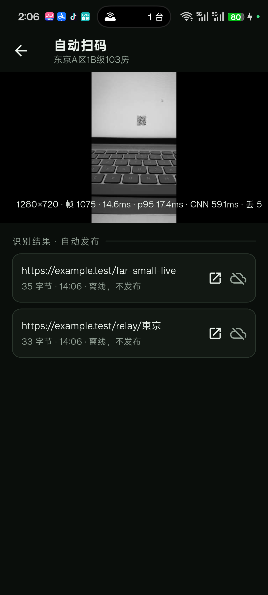

# Verification

Audit date: 2026-10-20, Windows x64. This is the evidence behind the README's
claims. It also lists what is **not** verified, so nothing here is mistaken for a
finished product.

## Gates

| gate | command | result |
|---|---|---|
| Rust format | `cargo fmt --all -- --check` | clean |
| Rust lints | `cargo clippy --workspace --all-targets -- -D warnings` | clean |
| Rust tests | `cargo test --workspace` | **143 passed** |
| Flutter analyze | `flutter analyze` | no issues |
| Flutter tests | `flutter test` | **29 passed** |
| Windows build | `flutter build windows --release` | built |
| Web build | `pwsh -File scripts/build-wasm.ps1` then `flutter build web --release` | built |
| Android build | `flutter build apk --debug` | built (arm64 Rust lib + Camera2 scanning + embedded server) |

### QR generation

- rxing encodes room/relay codes as 2048×2048 **lossless WebP** (error
  correction M, quality 90 / method 4, L8), the same parameters as rcrm's
  bridge. `qr_race_qr` tests decode the WebP back and scan it with the pipeline.
- Native FFI: `dart run tool/qr_probe.dart` against the release DLL produced a
  2452-byte RIFF/VP8L file that Pillow reads as 2048×2048.
- Web: the wasm export `qr_webp` produced the same 2048×2048 WebP in Node; the
  Flutter web build uses it through `camera_scan.js`.
- The Flutter UI renders these bytes with `Image.memory` and
  `FilterQuality.none`; `qr_flutter` was removed.

### Perturbed fixtures

- `qr_race_fixtures` generates ten deterministic scenes (texture, noise, blur,
  low contrast, gradient, rotation, perspective, small, multi-code, camera-like)
  from rxing codes; tests assert every expected payload decodes.
- `qr_bench --suite` reports per-scene timings; whole-frame multi-code is 44 ms
  (over the 33 ms budget) while the pyramid pipeline is 7.6 ms. Table in
  `docs/PERF.md`.

### Model conversion

- `tools/caffe_to_onnx.py` parses the WeChat Caffe prototxt/caffemodel with
  generated bindings and writes ONNX directly (no conversion service). The SSD
  extension fields are in `tools/caffe_wechat.proto`.
- SR: `models/sr.onnx` (24 KB) is numerically verified against an independent
  NumPy forward of the same weights, max abs diff **5.5e-06**, shape
  `1×1×447×447` from `1×1×224×224`.
- Detector: `models/detect.onnx` (1.19 MB) loads in ONNX Runtime and returns
  `mbox_loc [1,27648]`, `mbox_conf_flatten [1,13824]`,
  `mbox_priorbox [1,2,27648]`; softmax sums to 1. `DetectionOutput` is omitted;
  decode/NMS is the next step. No Caffe runtime was available for detector
  numeric parity (OpenCV 5 removed `readNetFromCaffe`).

### Linux central server

- Built `qr_race_server` for x86_64 Linux in WSL (Arch) and ran it with a
  generated self-signed certificate on port 18480. `qr_race_server fingerprint
  --cert` and the server log printed the same SHA-256
  (`956fadb0…fe942b`); `curl --cacert` + token-only `POST /v1/auth` returned
  `200`. `scripts/deploy-server-linux.sh --foreground` also generated config,
  certificate, token and fingerprint.
- The script prints URL, host token and fingerprint; certificate SANs include
  the public host, LAN IP, localhost and 127.0.0.1. Ubuntu uses the same binary
  (WSL Arch is the available Linux test environment, not a full Ubuntu host).

### WeChat CNN and tiered scanning

- `qr_race_wechat` is our implementation under `crates/`, not a dependency on
  the registry `wxscan` crate. ONNX weights load from `include_bytes!`; Android
  uses ORT, desktop tract. Tests cover the full pipeline, the tiered fast path
  and a small synthetic symbol through the CNN path.
- Device (OnePlus PLF110) HUD with ORT: clear-code fast path 2.9–6.8 ms; CNN
  384 5.5–15.9 ms; tiled far-code pass 21.4 ms (within the 60 ms budget).
  A live 11-vmin QR on the PC screen decoded
  `https://example.test/far-small-live`; the HUD showed fast 2.9 ms / CNN
  21.4 ms. Clear codes never trigger CNN.
- Formal device benchmark (20 fast / 10 CNN / 5 tiled iterations): fast p50
  6.8 ms, p95 6.9 ms; CNN 384 p50 5.5 ms, p95 6.9 ms; tiled far p50 21.4 ms,
  p95 21.8 ms.
- Real camera run at 1280×720 (1075 frames, QR plus far/small QR): HUD p95
  17.4 ms, last 14.6 ms, CNN 59.1 ms, dropped 5 frames; the far code
  `https://example.test/far-small-live` was decoded. This is one measured run,
  not a multi-device distribution.
  
- The live far/small case is now reproduced with ORT and the 2×2 tiled pass
  (real-camera p95 17.4 ms, CNN 59.1 ms, 5/1075 dropped). This is one run, not
  a multi-device detection-rate curve.
- Deterministic fixture suite: 10/10 scenes fully decoded (clean/noise/blur/
  low-contrast/gradient/rotated/perspective/small/multi/camera-like), all on
  the fast path; the separate synthetic small-code test exercises CNN/SR.
- Far-code synthetic sweep (1280×720 textured canvas, QR 50–300 px, box blur
  0/1/2 px): 17/24 combinations decoded. All 160/220/300 px cases hit on the
  fast path; 80–100 px with 1 px blur hit via CNN+SR; 50–60 px with blur, and
  ～120 px at 2 px blur, still miss. This is a distance proxy, not a field
  detection-rate claim.
- Vendored sources (crates.io) are under `crates/wxscan`, `crates/cvlite`,
  `crates/wxing`, `crates/wxscan-tflite`, `crates/wxscan-ffi`; only the first
  three are built as path dependencies. See `docs/VENDORED.md`.

### Self-host and Android device

- Desktop self-host now goes through the Rust bridge. The bridge spawns
  `qr_race_server` inside a Windows Job Object with `KILL_ON_JOB_CLOSE`;
  `dart run tool/selfhost_probe.dart` authenticated token-only, and a probe that
  exited without calling `stop` left **no** `qr_race_server` process and port
  18473 closed. Config/accounts/SQLite are reused from
  `%APPDATA%\qr_race\selfhost\desktop`.
- Desktop font fallback follows rcrm: `Microsoft YaHei / PingFang SC / SimHei /
  Noto Sans CJK SC` are applied to the text theme on desktop.
- Real Android device (OnePlus PLF110, `3B163Q00LSK00000`): debug APK installed
  via adb. With `adb reverse tcp:18471 tcp:18471`, the app connected to a server
  started by `scripts/deploy-server.ps1` using `https://127.0.0.1:18471`, the
  certificate fingerprint and a host token; the lobby rendered as `host`.
- Android self-host: `qr_race_embedded` is compiled into
  `libqr_race_ffi.so`. Starting from the UI on port 18443 generated a
  self-signed certificate, reported `https://127.0.0.1:18443` plus fingerprint,
  and “用此账号连接” authenticated with the token into the lobby. 8443 was
  already in use on this device, which is why the UI exposes the port.
- Per-room dynamic member: the host-only `POST /v1/room/guest?address=...`
  endpoint minted `guest-156ec94150ec` with a fresh token; that guest
  authenticated and joined the room, whose member list then showed
  `host` as host and the guest as member. No pre-provisioned member account was
  needed; invitations carry the guest token and a room address.
- Android camera: Camera2 YUV frames are pushed through JNI into Rust; the
  preview is rotated at the small preview size (not per full frame), scan time
  was 2–3 ms at 640×480, 7.8 ms at 960×720, and 6–16 ms at 1280×720 on device.
  Final live test: QR centered on the PC screen decoded
  `https://example.test/relay/东京` at 1280×720 / 13.5 ms and appeared exactly
  once. The preview keeps the previous frame between updates, removing black
  flicker.
- Duplicate hits are removed by decoded text as well as raw bytes (Rust), and
  auto-publish keeps a published-text set, so identical results are sent once.
- The FFI scan crate is built without `image-io` (no PNG/BMP decoders on the
  scan path). `image` remains only for the low-rate JPEG preview; `png` appears
  transitively via `rxing → imageproc` and is never called by the camera loop.
- Permission and links: CAMERA runtime dialog with Settings fallback;
  `MANAGE_EXTERNAL_STORAGE` request for arbitrary certificate paths; file picker
  copies into app cache. A `qrrace://connect?...` deep link filled server,
  fingerprint and token in the connect form.
- Auto-publish: scan hits are published without a button; payloads with the same
  prefix (`A:...`, `cam1|...`) update one room slot, different prefixes coexist.
  External links use the Android chooser (WeChat/WeCom/browser) with a copy
  fallback.

## Feature evidence

### Scan pipeline

- `docs/PERF.md`: whole-frame 1280×720 p50 4.629 ms; pyramid detect 2.331 ms with
  decode 0.127 ms; pyramid + on-demand bilinear super-res 4.037 ms (super-res
  1.319 ms). Stage timings come from the engine itself.
- Multi-code: generated 1280×720 scene with two symbols, pyramid pipeline returns
  both, byte-for-byte.
- wasm: `node tools/wasm_scan_probe.cjs` reads a dumped frame, scans 1280×720 in
  18–22 ms wall and prints the exact payload.
- Browser: `pwsh -File scripts/browser-scan-probe.ps1` runs Edge headless with a
  fake camera (Y4M of a QR page) and reports
  `HIT:https://example.test/relay`, 640×480, `scan_ms` ≈ 1.6.
- Real camera: camera access was enabled and the CLI scanned textured frames at
  1920×1080 (6.01 ms average, ~24 fps input) and 1280×720 (2.89 ms average,
  ~28 fps input); no QR was in view, so a live symbol was not decoded.

### Auth and rooms

- Token login; five bad tokens → `429`; verified by hub/API tests and a live
  process. TOTP is no longer requested by the UI; the legacy verifier remains
  only for callers that explicitly send a code.
- Room permissions: dark-room entry, host-only light/promote/demote,
  host/co-host-only publish — unit tests plus an HTTP end-to-end test.
- WebSocket: real socket test with a single-use ticket; end-to-end now has
  host + two members, both receive the same relay bytes.

### Persistence

- SQLite store tests cover rooms, relays, trimming, and reopening the file.
- Real-process restart: create/light/publish → stop → start → `GET /v1/room`
  returns `lit=true` and the same relay bytes.

### Transport security

- Generated self-signed certificate is reused on restart and its SHA-256 is
  printed.
- TLS integration test performs a real handshake with the certificate trusted by
  the client (no `danger_accept_invalid_certs`).
- Live checks: `curl -k` 200, `curl --cacert` 200, Python with verified TLS
  authenticates, Dart `tool/tls_probe.dart` authenticates with fingerprint
  pinning; a wrong fingerprint fails the handshake.
- CLI integration test publishes through HTTPS using `--cacert`.

### Extensions

- No Python/RustPython runtime or module upload UI. The internal extension
  catalog (manifest/API/store) remains as an unused seam; it is not exposed in
  Flutter and not part of acceptance. Extension points are documented in
  `docs/EXTENSIONS.md`.

### Clients

- CLI: image scan + publish, camera scan/publish, `--list-cameras`, `--probe`,
  `--cacert`, tested against a live server.
- Desktop FFI: C ABI state/preview and Dart binding; widget tests for the scan
  page.
- Flutter: connect (including certificate fingerprint), lobby, room, host
  actions, scan page; 30 tests at desktop and phone sizes.

## Known gaps

1. **CNN speed is within the relaxed budget.** Synthetic p95: fast 6.9 ms,
   CNN 6.9 ms, tiled far 21.8 ms. One real-camera run: p95 17.4 ms, CNN 59.1 ms,
   5/1075 dropped, far code decoded. Multi-device/rate sweeps remain.
2. **No Python modules.** Removed from the product; only the unused internal
   extension catalog and Rust extension seams remain.
3. **Apple capture does not exist.** iOS/macOS cannot be built or verified on
   Windows; Android now has its own Camera2 capture and in-process server.
4. **No browser UI run.** Edge headless drove the scan probe page, but the Flutter
   web UI itself was not manually exercised in a browser.
5. **No remote or CI.** History is the initial scaffold plus implementation
   commits from this session; nothing has been pushed and no CI ran.

## Reproduce

```powershell
cargo fmt --all -- --check
cargo clippy --workspace --all-targets -- -D warnings
cargo test --workspace

pwsh -File scripts/build-wasm.ps1
node tools/wasm_scan_probe.cjs
pwsh -File scripts/browser-scan-probe.ps1

cd crates/qr_race_gui
flutter analyze
flutter test
flutter build web --release
flutter build windows --release
flutter build apk --debug

# self-host launcher (starts a real server, authenticates, stops it)
dart run tool/selfhost_probe.dart

# Android device (builds, adb reverse, installs, launches)
pwsh -File scripts/android-deploy.ps1 -Port 8443
```


